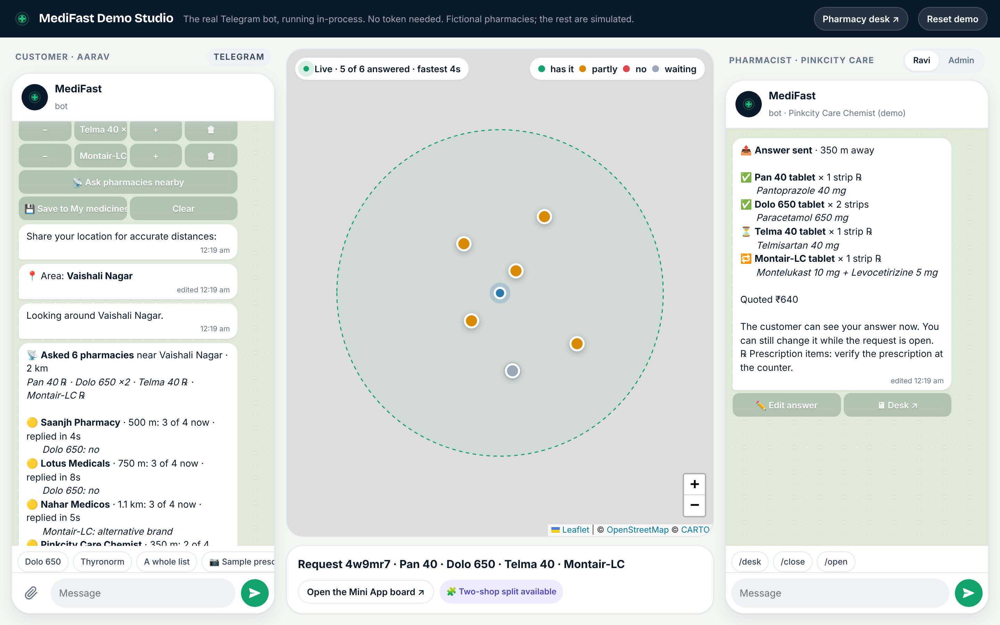
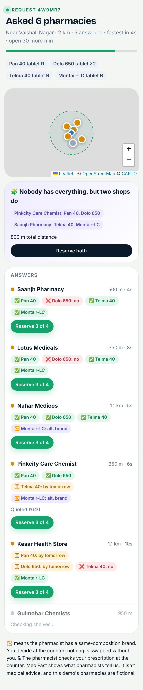
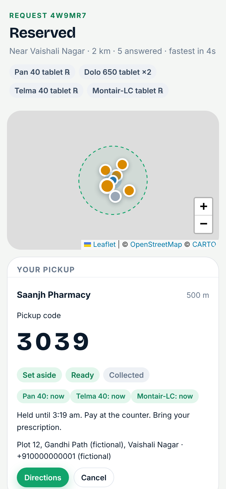
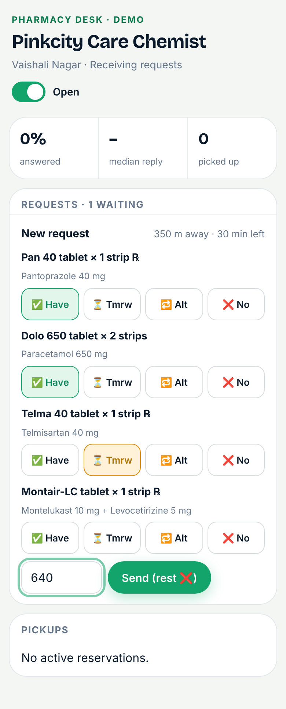

<div align="center">


# MediFast

**Ask every chemist nearby. At once.**

Send your medicine list on Telegram. Nearby pharmacies tap what they have.<br />
You see the answers live, reserve, and pick up.

[](https://github.com/Ruchin-Audichya/MediFastRX-Bot/actions/workflows/test.yml)




</div>

---

## 💡 The idea

You have a prescription. The first chemist doesn't have one of the medicines. Neither does the second.

Apps that list pharmacy stock don't fix this, because small chemists can't keep a stock database up to date.

**MediFast asks the pharmacist instead.** Your list goes to every participating pharmacy near you at the same time. Each one answers in a few taps. You know where to go before you leave home.

## ✨ How it works

| | |
| --- | --- |
| **1. 🧾 Make your list** | Type `Dolo 650`, paste a list, or send a photo of your prescription. You confirm the exact strength and form. |
| **2. 📡 Ask nearby** | Pick 1, 2 or 5 km. Your list goes to every participating pharmacy in that circle. |
| **3. ⚡ Watch answers arrive** | Pharmacists tap ✅ have · ⏳ by tomorrow · 🔁 other brand · ❌ no. One message in your chat updates itself. |
| **4. 🎟 Reserve and pick up** | Reserve the best shop, or split your list across two. Show your 4-digit code and pay at the counter. |

<p align="center">
  
  &nbsp;
  
  &nbsp;
  
</p>
<p align="center"><sub>Live answers · Pickup code · Pharmacy desk</sub></p>

## 🏪 For pharmacies

- Requests arrive in **Telegram**, on the phone already at the counter. No new app.
- **One tap per medicine.** No stock spreadsheets, ever.
- Customers walk in with a code and their items already set aside.
- Sign up by sending `/partner` to the bot. An admin checks the licence before you go live.

## 🛡️ Built to be careful

- **Exact matches only.** `Pan 20` never quietly becomes `Pan 40`. Anything unsure needs your tap.
- **℞ stays ℞.** Prescription medicines are marked, and the pharmacist checks the prescription at pickup.
- **No silent swaps.** A pharmacist can say "other brand available"; you decide at the counter.
- **Habit-forming medicines are never broadcast.**
- **Private.** Pharmacies see your list and distance, not who you are. Prescription photos are read once and thrown away.

## 🚀 Try it in one minute

**Easiest: double-click a launcher** in the [`launcher`](launcher/) folder.

| Your computer | Double-click |
| --- | --- |
| Windows | `launcher/MediFast Demo (Windows).cmd` |
| macOS | `launcher/MediFast Demo (Mac).command` (first time: right-click → Open) |
| Linux | `launcher/medifast-demo-linux.sh` |

The launcher checks Node.js (and opens the download page if it's missing), installs and builds on the first run, starts MediFast on a free port with a fresh demo, and opens **Demo Studio** in your browser. Keep the window open while you demo; close it to stop. After the first run it works without internet; only the map background and web fonts need a connection.

**Or from a terminal** (Node 22.18 or newer, no database, no API keys):

```bash
npm ci
```

```bash
npm run demo
```

Demo Studio runs the real bot with a customer, a pharmacist and an admin side by side, plus a live map. Type `Dolo 650` and follow along.

**Want the real Telegram bot?** [docs/GO_LIVE.md](docs/GO_LIVE.md) takes you from a [@BotFather](https://t.me/BotFather) token to a public bot in about 30 minutes (`npm run bot:check` verifies your token). To run a pilot with real pharmacies, use the [pilot kit](docs/PILOT_KIT.md) and its printable [pharmacist guide](docs/pilot/pharmacist-guide.pdf).

## 🧱 Under the hood

```
Telegram  ─┐
Studio    ─┼─▶  Bot  ─┐
Web app   ─┴─▶  API  ─┼─▶  Domain rules  ─▶  SQLite
                      │        │
                      │        └─▶ Notifier ─▶ live message edits
                      └─▶ Catalog matcher (exact strength & form)
```

- **One process, one database.** Node 24 runs TypeScript directly; SQLite is built in.
- **One brain.** Every rule lives in `src/domain/medifast.ts`. Telegram, the web and the demo all call it.
- **Tested end to end.** 27 tests, including full Telegram conversations. CI runs them on every push.

📖 More: [Architecture](docs/ARCHITECTURE.md) · [Go live](docs/GO_LIVE.md) · [Deploy](docs/DEPLOY.md) · [Pilot kit](docs/PILOT_KIT.md) · [Demo script & viva notes](docs/DEMO_AND_VIVA.md)

## 📝 Good to know

MediFast is a 7th-semester major project. It isn't a pharmacy: it doesn't sell, prescribe or deliver medicines, and it isn't medical advice. The pharmacies in the demo are fictional and their replies are simulated. The medicine catalog is a starter set and should be checked against pack labels before a real pilot.

<div align="center"><sub>MIT licensed · Made with care in Jaipur 🩷</sub></div>
