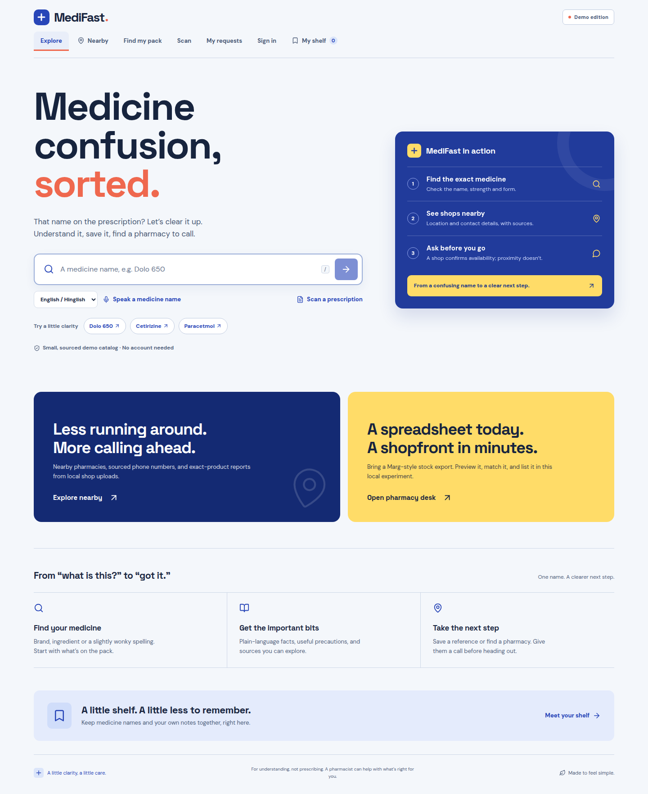

# MediFast v2

**Medicine confusion, sorted.**

A local pharmacy discovery and availability-request application. Search an exact medicine, scan a printed prescription into an editable list, and ask a participating pharmacy to confirm it. The pharmacist reviews the request; the customer sees the status change live.

Built with Next.js + React, one Express API and one SQLite database. The web app needs no Telegram token, MongoDB service, AI key or paid map key. An optional Telegram adapter uses the same medicine and pharmacy services. This is a working local experiment, **not a licensed dispensing, delivery or payment service**.



[Phone home](docs/screenshots/home-phone.png) · [Medicine result](docs/screenshots/signal-medicine-desktop.png) · [Nearby search](docs/screenshots/signal-nearby-phone.png) · [Live request timeline](docs/screenshots/request-confirmed.png) · [Editable prescription scan](docs/screenshots/prescription-scan.png)

## Start on this computer

```bash
cd ~/Desktop/MediFast-v2
npm run dev
```

Open **http://127.0.0.1:3000**. The API runs on loopback port 3101. Ctrl+C stops both. Dependencies and a local Node 24.22.0 runtime are already installed in this prepared checkout. The launcher selects that runtime if your shell uses another Node version.

For a fresh checkout on another Ubuntu computer:

```bash
nvm install
nvm use
npm ci
npm run dev
```

Use Node **24 LTS**, as specified by `.nvmrc`, package engines and CI. Image OCR works immediately; PDF OCR additionally needs `pdftoppm` (`sudo apt install poppler-utils`). English OCR data is bundled as an npm dependency; first search or scan does not download a transformer model.

No `.env` is necessary. Copy `.env.example` to `.env` only to change settings. Keep it untracked.

## Telegram assistant

```bash
npm run bot:demo           # Offline terminal simulation, no credentials
npm run bot:check          # Verify your configured Telegram token
npm run bot                # Run the private-chat assistant by long polling
npm run dev:all            # Web + API + Telegram, after configuring the token
```

Put `TELEGRAM_BOT_TOKEN` in an untracked `.env`. The bot supports exact medicine lookup, explicit typo/strength choices, Hinglish follow-ups, optional AI evidence summaries, and sourced nearby pharmacy phone/address/directions. Context expires; stale buttons and duplicate deliveries are handled. Web handoff preserves the selected product and keeps requests behind authentication. See [Telegram setup, walkthrough and webhook deployment](docs/TELEGRAM.md). The web app starts without Telegram.

## Try the complete demo

Sign in using the demo buttons. All three share the deliberately public password `DemoPass!2026`:

| Role | Email | What it does |
| --- | --- | --- |
| Customer | customer@medifast.demo | Request exact products, watch updates, scan the fictional sample |
| Pharmacy | pharmacy@medifast.demo | Review requests, confirm stock, prepare pickup, manage inventory |
| Admin | admin@medifast.demo | Approve profiles, inspect audit events, review catalog sources and reports |

1. Sign in as **customer**, search **Dolo 650**, and choose **Request this exact medicine**.
2. Select **Demo · Green Corner Pharmacy** and submit a request. Its inventory and prices are explicitly fictional.
3. Open an **incognito window or a different browser** at the same URL. Sign in as **pharmacy**. Two normal tabs share cookies, so use independent sessions.
4. Open the request, start review, check the pharmacist-review box and enter a review note. Confirm it, then move through preparing → ready → completed.
5. Watch **My requests** in the customer window update through server-sent events without reloading.
6. Open **Scan**, choose the fictional demo image, consent to local processing, and scan. Edit the extracted lines if needed, look up candidates, and explicitly select Dolo 650 and Cetirizine 10 mg. **Find these medicines** compares the whole confirmed list.

The shared customer account accepts only the provided fictional image. Create your own account to scan another image or PDF. Never use real patient information in a public demo. OCR output is not an approved prescription; every request requires recorded pharmacist review before confirmation, including products whose prescription classification is unknown.

Stop the app before resetting fictional data:

```bash
npm run demo:reset
npm run dev
```

Reset clears all accounts and activity created in **demo mode**, including private demo registrations and uploads. It refuses a database containing live accounts. It does not delete or replace the medicine catalog.

## What is real, and what is simulated?

| Data | Meaning |
| --- | --- |
| Included medicine catalog | Nine sourced demonstration records; incomplete, not a clinical formulary |
| **Nearby** public directory | Internet-sourced shop locations and available contacts from Photon/OSM, plus four dated Jaipur listings from official pharmacy pages; **stock unknown** |
| **Find my pack** in demo mode | Fictional partner with fictional inventory, quotes and pharmacist actions |
| Approved live partner | Operator-managed stock, with source, exact product identity and timestamp; not independently audited inventory |
| Request confirmation | That participating operator reviewed the request and reserved local reported packs; not a payment or dispensing event |

Public listings never acquire demo inventory. Missing phone numbers remain missing. “Call to confirm” appears on public listings. Hours are displayed as unverified source text; no unsupported “open now” claim. The interactive map is optional and lists work without tiles. Location permission is requested only after pressing **Use my location**; manual area search starts with Jaipur.

## Everyday features

- Exact names and aliases first; bounded typo suggestions require confirmation. Strength, formulation, release markers and combinations are preserved.
- English and common Hinglish phrases, visible confirmed-medicine context, follow-up chips and explicit reset. Unknown medicine facts are never generated.
- Optional browser voice input produces editable text; browser support and microphone access vary.
- Medicine details, sources, missing-information states, and a local reference shelf with notes and recent searches. The shelf is not a medication schedule and is stored per browser origin, not per account.
- Authenticated pharmacy registration and admin approval, manual inventory, 24-hour freshness, exact-product CSV import preview, request timelines and audit history.
- Customer cancellation, expiry, rejected/unavailable responses, optimistic revisions, idempotent creation and transactional stock reservation.

## Bring a stock spreadsheet

In the pharmacy dashboard, open **Inventory**. Download the template or paste a UTF-8 CSV/TSV with:

```csv
Item Name,Strength,Form,Closing Stock,Unit,Packing,MRP,Expiry
Dolo,650 mg,tablet,12,strips,15 tablets,30,2028-06
```

A Marg-style exported stock report can use the recognized headings. This is a **file importer, not a direct Marg ERP integration**. Preview shows exact matches and skipped rows. Wrong strengths, ambiguous products, expired stock, invalid amounts and duplicate products are skipped. Consolidate batches into available packs yourself. Applying a preview replaces counts for those products; it does not add them or clear other products. Concurrent changes invalidate stale previews. Imported expiry dates are retained and invalidate stock at the end of that date in India time; month-only expiry means month-end. Manual updates are a new operator attestation of saleable, non-expired packs and must exclude already reserved packs. Preview tokens last ten minutes and belong to the signed-in operator.

## Catalog and optional services

```bash
npm run catalog:import -- data/imports/your-reviewed-catalog.json
```

See [data schema and provenance](data/README.md). Import validates structure, not clinical truth. It atomically replaces the catalog; back up valuable data first. An identity change invalidates old inventory rather than relabeling stock. Never reuse a medicine ID for another product.

`PHARMACY_MODE=live` uses public internet discovery. `PHARMACY_MODE=demo` uses visibly fictional nearby samples. Provider failure shows a recoverable error; live mode never silently substitutes samples. Public endpoints have no availability guarantee. Respect provider terms before a public deployment.

Optional `GROQ_API_KEY` enables selection of supplied evidence sentences. Core medicine search never waits for it. Missing, slow or malformed responses fall back to the catalog. The AI cannot create a medicine profile from memory.

For a participating-pharmacy pilot, use a **separate database**, `APP_MODE=live`, and create the initial admin with `npm run seed`, supplying `ADMIN_EMAIL` and a private `ADMIN_PASSWORD` of at least 16 characters through your environment. Remove that bootstrap password afterwards. Demo accounts cannot sign in in live mode. Registrations require admin review before a partner is visible. See [deployment and privacy requirements](docs/DEPLOYMENT.md).

## Build and verify

On this prepared computer, select the bundled runtime for commands other than the launcher if needed:

```bash
export PATH="$PWD/.local/node-v24.22.0-linux-x64/bin:$PATH"
npm test
npm run typecheck
npm run build
npm start
```

The production build also opens at http://127.0.0.1:3000. Stop the development server first. To run browser checks, stop any Next development process in this checkout, then:

```bash
npx playwright install chromium
npm run test:browser
# Or use installed Chrome without downloading another browser:
PLAYWRIGHT_CHROME_PATH=/usr/bin/google-chrome npm run test:browser
npm run measure
```

Browser tests run isolated demo data on ports 5174/3104. Measurements use loopback HTTP and local demo data. [BUILD_REPORT.md](BUILD_REPORT.md) records actual results, baseline failures, limitations and the demonstration. [Architecture](docs/ARCHITECTURE.md) explains the design.

## Honest limits

Small catalog; printed English OCR works better than handwriting; PDF scanning reads only the first three pages. No email verification/password recovery/2FA, real license verification integration, payments, delivery, WhatsApp/SMS, direct POS sync or substitute proposal flow. Admin review is a recorded human action, not regulatory certification. Authenticated lists are bounded to 100 recent records; pagination is future work. The UI is a single application with in-memory screen navigation, not a set of shareable routes.

Before real operation in India, obtain licensed pharmacy participation and professional review of applicable drug-sale, prescription and data-protection requirements. This software does not claim regulatory compliance.

## Repository history

This checkout is `/home/ruchinaudichya/Desktop/MediFast-v2`, branch `feat/medifast-v2`, based on `main` at `d399ef3`. Both `main` and `careops-servicenow` were inspected. Useful identity, typo, evidence and context behavior was carried forward from the earlier Studio refactor. Old branches and the previous Studio checkout remain intact. Release work is published on the feature branch when credentials permit; main is preserved and nothing is deployed. See BUILD_REPORT.md for the final publication result.

Retired: ServiceNow/CareOps direction (never imported from its branch), the original duplicated Telegram orchestration (replaced by the optional shared-service adapter), Mongo/vector infrastructure, model-memory unknown-medicine fallback, duplicated routing/context, misleading stock rankings, obsolete operational endpoints, SOS/family flows and abandoned deployment scaffolding. Tests for retained behavior were migrated; historical code and tests remain in Git history.
