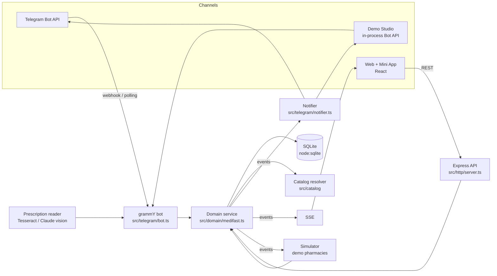
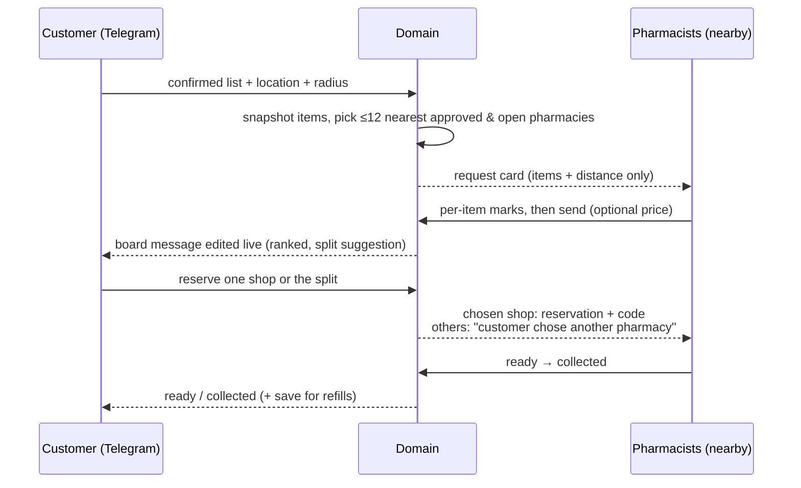
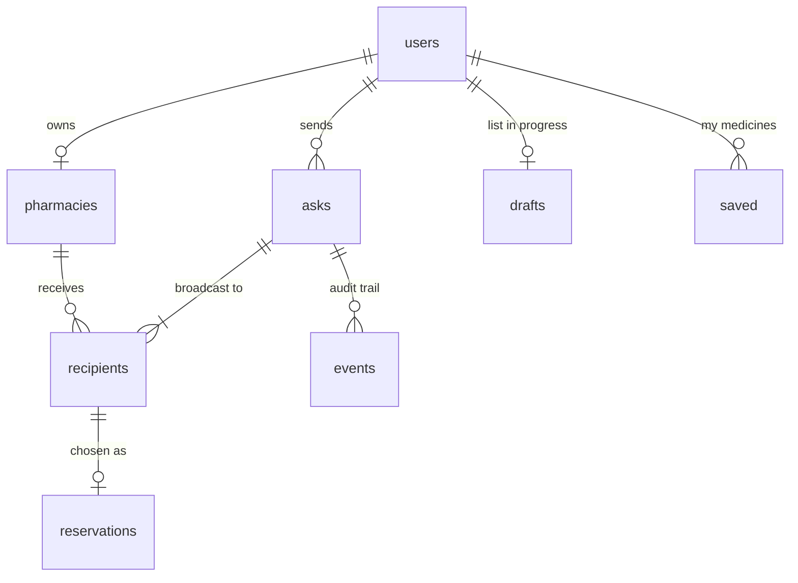

# Architecture

MediFast is deliberately **one process, one database, one bot codebase**. That is enough for a city pilot, easy to explain, and easy to deploy on a single small instance.

## Components

| Layer | Responsibility | Never does |
| --- | --- | --- |
| Catalog (`src/catalog`) | Parse identity (name, strength, form, release), resolve text to products | Guess, or swap a strength/form |
| Domain (`src/domain/medifast.ts`) | Every business rule, authorization and state transition, in SQLite transactions; emits events | Know about Telegram or HTTP |
| Bot (`src/telegram/bot.ts`) | Turn chat input into domain calls; conversation state (onboarding, price entry) | Render updates for other users |
| Notifier (`src/telegram/notifier.ts`) | Render domain events as Telegram sends and edits | Change state |
| HTTP (`src/http`) | REST + SSE for the web, Mini App auth, Studio endpoints, webhook | Contain rules |
| Simulator (`src/studio/simulator.ts`) | Play fictional pharmacies through the same domain calls as humans | Quote prices or invent anything beyond yes/no answers |

Because the notifier is the only renderer, an answer submitted from the web desk, from Telegram, or by the simulator updates the customer's board message and map the same way.

## The core loop

## State machines

**Ask**: `open → reserved | expired (30 min) | cancelled`

**Recipient** (one per pharmacy per ask): `pending ⇄ answered → chosen | closed | expired`. A sent answer can be re-opened for editing while the ask is open; the customer keeps seeing the previous answer until it's re-sent.

**Reservation**: `held → ready → collected`, and `held|ready → cancelled (customer) | declined (pharmacy) | expired (hold time)`. Repeating the same transition is idempotent; anything else is rejected.

## Data model

- `asks.items` stores **identity snapshots** (brand, composition, form, schedule, qty). Catalog edits later can never change what a pharmacist answered.
- `recipients.draft` holds a pharmacist's private marks; `recipients.answers` is what the customer sees.
- `users.ref` is transport-qualified (`live:<telegram id>`, `studio:1001`, `sim:<key>`), so live users, studio personas and simulated pharmacists share one schema without collisions.
- `events` is an append-only audit log per ask.

## Matching rules

1. **Ingredient names** (`paracetamol 650`) list every product containing that ingredient, filtered by any strength or form given. The person picks the brand.
2. **Brand or alias names** must also agree with any explicit strength, form or release (`SR`, `XL`…). A mismatch returns `no-such-variant` with the variants that do exist.
3. Otherwise there's a **bounded fuzzy** pass (edit distance scaled to length, phonetic key, prefix). It only ever *suggests*.
4. Lists are split on newlines, commas, semicolons, "and"/"aur", with trailing quantities (`x2`, `3 strips`).
5. Products with schedule `restricted` (habit-forming) can't be added or broadcast.

## Security and privacy

- **Authorization in the domain:** pharmacists act only on requests sent to their pharmacy; customers only on their own asks and reservations; admin actions need `is_admin`.
- **Pharmacists never see competitors' answers.** The board API is customer/admin-only, and SSE events carry ids only, so clients refetch through authorized endpoints.
- **Mini App auth:** `initData` is verified with HMAC-SHA256 against the bot token and expires after 24 hours.
- **Webhook:** Telegram's secret-token header is required.
- **Prescription photos:** downloaded, read once, discarded. Only the extracted lines continue, and only after the customer confirms them.
- **Rate limits** on HTTP; per-customer limits on open asks (2) and daily asks (12); bounded inputs everywhere.
- CSP, helmet headers, and framing allowed only for Telegram's web client.

## Knowledge base (no LLM)

`src/kb/kb.ts` answers medicine questions deterministically. A small pattern matcher recognises the intent (*about*, *brands*, *generic*, *strengths*; English and common Hinglish). The resolver finds the product or salt, and the answer is assembled from the catalog plus the optional Jan Aushadhi list (`data/janaushadhi.json`, created by `npm run import:janaushadhi`). Every fact shown is traceable to a row of data, and unknown names produce "no information" instead of a guess.

## Find: medicine + pincode → where to get it

`GET /api/find?q=…&pin=…` (`src/find/find.ts`) runs in three steps:

1. **Confirm the product.** The same exact-match resolver used by the bot. If the name is
   ambiguous, it returns a `choose` stage, so strength is never guessed.
2. **Resolve the pincode** (`src/geo/pincode.ts`):
   - first from the `pincodes` table, which is filled by `npm run import:pincodes` from the India
     Post directory, or seeded with the demo areas;
   - otherwise from OpenStreetMap Nominatim. Lookups are rate-paced at 1 per second, the result is
     checked against India's bounds, and it is cached, including "not found" for 7 days.
3. **Run the providers in parallel** (`src/find/providers.ts`). Each has a timeout and error
   isolation, and each returns `ok | empty | unavailable | skipped` plus a **verification label**:

| Provider | Source | Verification |
| --- | --- | --- |
| `network` | Participating pharmacies within 2, then 5 km | `pharmacist-confirms`. The user sends an ask, and pharmacists answer it |
| `directory` | OpenStreetMap Overpass `amenity=pharmacy` within 3 km, cached for 24 hours | `location-only`. Stock is unknown |
| `online` | Search links for 1mg, PharmEasy, Apollo 24\|7 and Netmeds, with Blinkit last | `not-checked`. No scraping. Optional affiliate parameters are disclosed |

Restricted (habit-forming) products skip `network` and `online`.

External HTTP goes through `src/net/http.ts`, which provides a timeout, per-host pacing, an
identifying User-Agent, and a SQLite TTL cache (`cache` table). Set `EXTERNAL_LOOKUPS=false` to run
fully offline.

**Website visitors** can send an ask without Telegram:

- `POST /api/web/session` returns a random 48-hex token. It is kept in the browser, and only its
  SHA-256 is stored, as the user ref `web:<hash>`.
- `POST /api/web/asks` creates an ask (6 per hour per IP, plus the usual per-customer limits).
- The live board at `/app/ask/:id` is visible only to that token.

On Telegram, typing a 6-digit pincode sets the location, as an alternative to sharing it.

## Why these choices

- **Telegram first:** no install for either side, push notifications for free, and an editable message is a natural live board. In India the equivalent at scale would be WhatsApp Business; the domain is channel-agnostic, so that's a new adapter, not a rewrite.
- **Ask, don't index:** avoids the stale-inventory problem entirely and makes supply-side onboarding nearly free.
- **Not Supabase (yet):** a hosted Postgres would add an internet dependency (the offline demo would break), cloud credentials and a second service, without fixing any current limit. When multiple server instances are needed, move to PostgreSQL (Supabase is one host for it); the domain API stays the same.
- **SQLite + one process:** transactions keep reservations and state transitions consistent without a separate database server. Scaling to multiple instances would mean moving the event bus and SQLite to Postgres + a queue; the domain API wouldn't change.
- **Node type stripping:** the server runs `.ts` files directly (no build step); `tsc` is used only for type checking.
